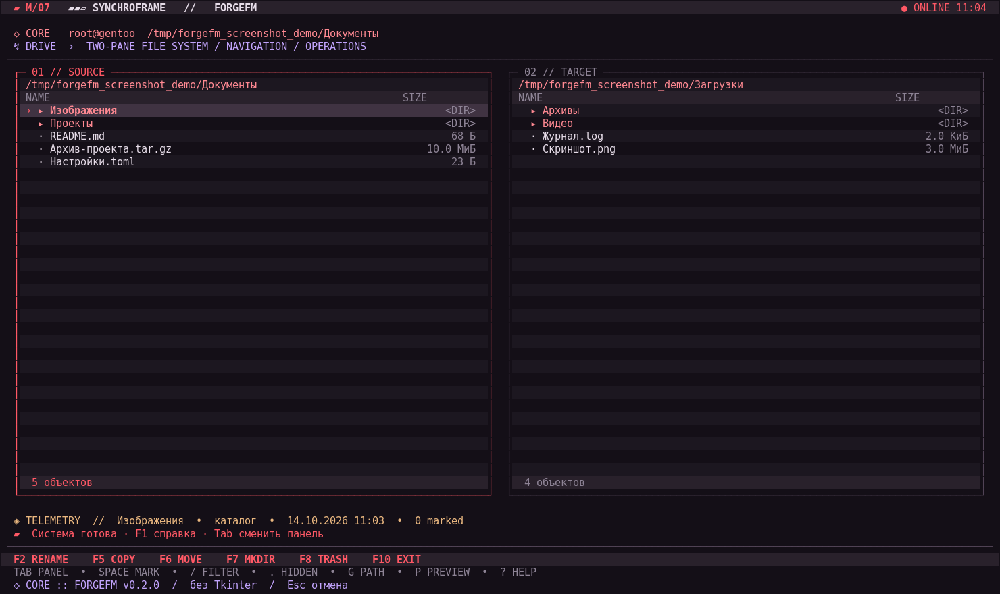
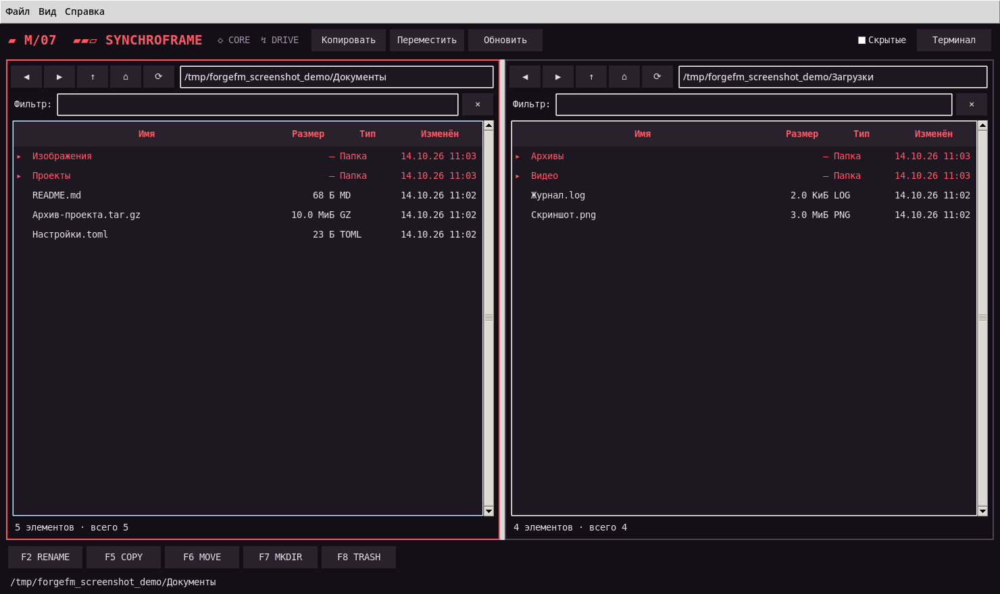

# ForgeFM M/07 v0.4.1 — Red / SYNCHROFRAME / GTK4

Отдельный GTK4-файловый менеджер для Gentoo, один список файлов, двойной щелчок для открытия папок и файлов. Это обновление изменяет оформление v0.4.0, сохраняя файловое ядро и вычисление размеров каталогов.

## Изменения 0.4.1

- Акцентный цвет GUI, иконки приложения, терминального интерфейса и запасного Tkinter GUI — красный (`#ff5865`); подсветки и выделения согласованы с красной палитрой. **Это выбранный красный в духе Konsole, но не автоматическое считывание пользовательской схемы Konsole**: SYNCHROFRAME не содержит файла `.colorscheme`.
- Верхняя титульная строка возвращена к оформлению **v0.3.0**: высота 66 px, две строки `FORGEFM` + `SYNCHROFRAME // FILE SYSTEM`, увеличенный заголовок и правый статус `ONLINE // GENTOO`.
- Иконки панели слева: **26 px** вместо 30 px для мест и **24 px** вместо 28 px для действий.
- Нижняя полоса — **не всплывающее меню**, а статическая строка состояния: путь, счётчики файлов и состояние операций. Она стала ниже (30 px), убраны длинные подсказки сочетаний. Она не открывается по наведению или прокрутке.
- Если при движении мышью к самому низу экрана появляется панель приложений KDE Plasma, это системная автоскрываемая панель. Её поведение меняется в настройках Plasma, а не в ForgeFM.
- Подсчёт размеров папок (включая вложенные файлы и скрытые элементы), просмотр типов/дат, фильтр, открытие **двойным щелчком** и горячие клавиши остаются как в 0.4.0.

## Пользовательская установка / обновление (без `sudo`)

Для версии `python3` с PyGObject/GTK4:

```sh
sudo emerge --ask gui-libs/gtk dev-python/pygobject
python3 -c 'import gi; gi.require_version("Gtk", "4.0"); from gi.repository import Gtk; print("GTK4 OK")'
```

Распакуйте архив из `~/Загрузки`:

```sh
cd ~/Загрузки
unzip ForgeFM-M07-Gentoo-Desktop-0.4.1.zip
cd forgefm-m07-v0.4.1
./install.sh
forgefm
```

Установщик заменяет код текущего пользовательского ForgeFM и ярлык в меню, но не перезаписывает конфигурацию `~/.config/forgefm/config.json`. Если программа не в `$PATH`, запустите `~/.local/bin/forgefm`. **Не запускайте `./install.sh` через sudo**.

Запуск TUI: `forgefm --tui`. Предыдущий Tk GUI: `forgefm --legacy-gui` (требует tkinter). `./uninstall.sh` удаляет пользовательскую установку. Локальный необязательный Portage overlay находится в `overlay/` (не проверен на Gentoo).

## Тестирование

```sh
python3 -m unittest discover -s tests -v
```

Размеры — сумма логических размеров файлов, не занимаемых блоков на диске; ссылки не обходятся. Для очень больших каталогов расчёт выполняется в фоне. Код GTK4 в среде сборки нельзя проверить запуском из-за отсутствия PyGObject, поэтому требуется запуск на целевом Gentoo.


## Скриншоты

Ниже — настоящие снимки работающих режимов ForgeFM v0.4.1, сделанные
на тестовых демонстрационных папках, не в Gentoo пользователя.

**Терминальный режим (TUI):**



**Предыдущий двухпанельный Tkinter GUI (`--legacy-gui`):**



> Важно: изображения выше НЕ являются скриншотом основного однооконного GTK4-интерфейса.
> Для его точного изображения откройте ForgeFM v0.4.1 на Gentoo и выполните
> `./tools/capture-gtk4.sh` в каталоге репозитория. Скрипт сохранит файл
> `docs/screenshots/forgefm-gtk4.png`. Его можно добавить в GitHub
> командой `git add docs/screenshots/forgefm-gtk4.png && git commit -m 'docs: add GTK4 screenshot' && git push`.
